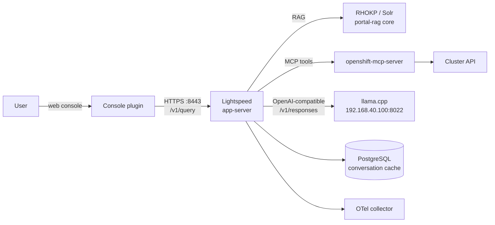

# OpenShift Lightspeed with a locally served LLM

Deployment notes for **Red Hat OpenShift Lightspeed 1.0** on the `luke` OpenShift cluster, pointing at a **local llama.cpp server** instead of a cloud LLM provider. Includes verified configuration, the exact commands used, and every issue hit along the way (with root causes and upstream references).

| Component | Detail |
|---|---|
| Cluster | `luke` — OCP 4.22, Kubernetes v1.35.6, RHCOS 9.8 |
| Topology | **3 nodes**: 1 arbiter (`192.168.40.25`) + 2 control-plane/worker (`192.168.40.26`, `.27`). This is **not** a single-node (SNO) cluster. |
| API | `https://api.luke.syangsao.net:6443` |
| Lightspeed | 1.0, operator installed via OLM (`openshift-lightspeed` namespace) |
| LLM | llama.cpp (`ghcr.io/ggml-org/llama.cpp`, build 11669), `Qwen3.8-27B UD-IQ4_XS`, 262K ctx |
| LLM endpoint | `http://192.168.40.100:8022/v1` (LAN host) |
| Provider type | `openai` (OpenAI-compatible API) |
| Status | ✅ RAG/docs answers and MCP cluster-interaction tool calls verified end-to-end |

> ⚠️ The LLM URL and hostnames below are from the reference environment; substitute your own.

## Architecture



## Quick start

```bash
# 1. Secret (placeholder token; llama.cpp needs no auth but the field is required)
oc create -f manifests/secret.yaml

# 2. OLSConfig
oc create -f manifests/olsconfig.yaml

# 3. Watch the rollout (images pull, then Solr warms up — first boot takes ~5-15 min)
oc get pods -n openshift-lightspeed -w
```

Full procedure, including CLI verification with a real OAuth token: [docs/setup.md](docs/setup.md).

Issue log with root causes and upstream links: [docs/issues.md](docs/issues.md).

## Verified behaviour

| Query | Path exercised | Result |
|---|---|---|
| "What is a SNO OpenShift cluster? Answer in one sentence." | RAG (Solr) + docs tool | Correct answer, 5 `referenced_documents` |
| "How many nodes are in my cluster? Name them." | MCP cluster tool (`resources_list`) | Correct 3-node table with IPs |

See [docs/verification.md](docs/verification.md) for exact commands and outputs.

## Layout

```
manifests/
  olsconfig.yaml               # OLSConfig CR (provider, model, guardrails)
  secret.yaml                  # apitoken secret
  llama-cpp-compose-change.md  # server-side change to llama.cpp compose + revert
docs/
  setup.md                     # step-by-step deployment and testing
  issues.md                    # issue log: symptoms, root cause, status, workaround
  verification.md              # smoke tests and observed outputs
```
